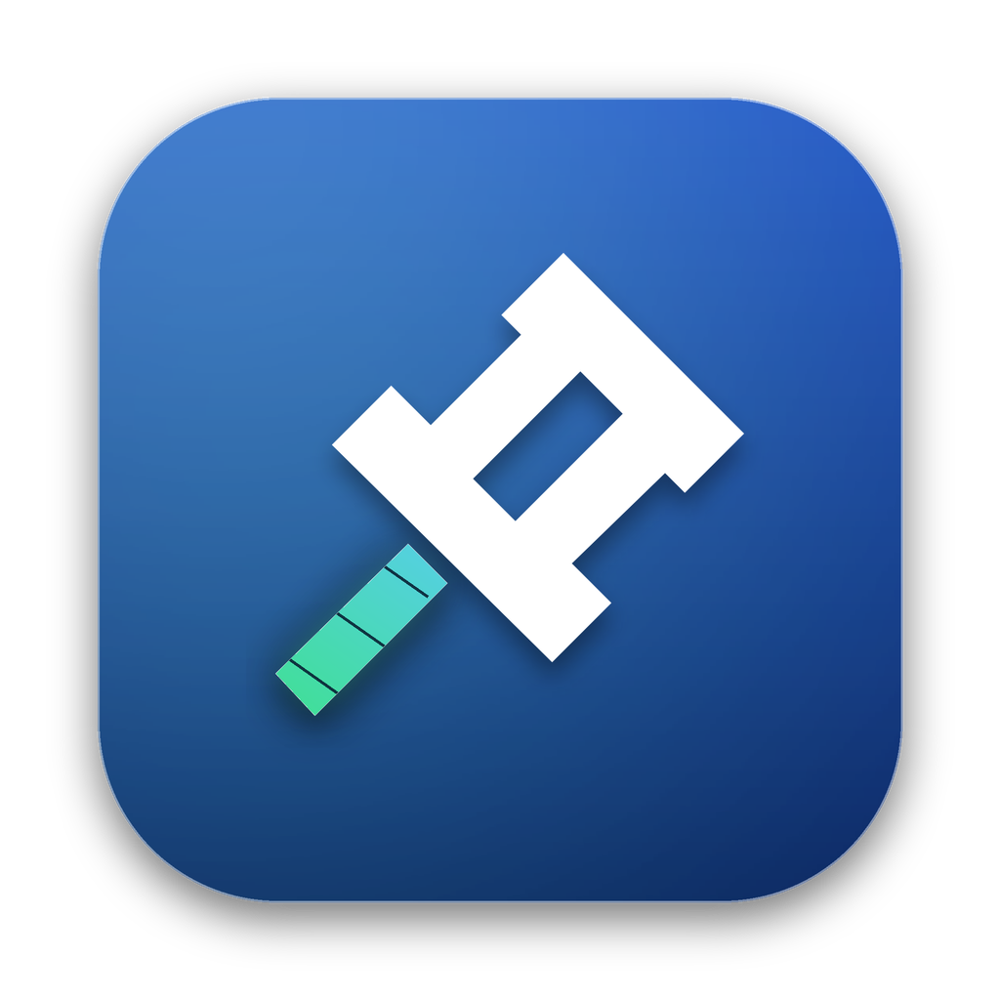
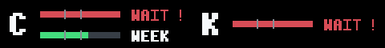

<p align="center">
  
</p>

# AI Touch Bar

**也许，现在才是 Touch Bar 的「最佳赏味期限」。**

以前总觉得 Touch Bar 没什么用。直到 AI 开始在后台思考、跑命令、改文件——这条被闲置的小屏，终于有了值得常驻的内容。

AI Touch Bar 是一个原生 macOS 菜单栏小应用，把 **Codex / Kimi Code 的额度与任务状态**放到 Touch Bar：不必反复切窗口，也不用一直盯着一串百分比。

[下载安装包](https://github.com/tigerrrr2020/ai-touchbar/releases/tag/v0.2.3) · [从源码构建](#从源码构建) · [开发交接](docs/HANDOFF.md) · [隐私与数据访问](docs/PRIVACY.md) · [MIT 许可证](LICENSE)

> 当前版本：**0.2.3 · 实验性预发布版**，源码与 Apple Silicon 安装包均已发布，包含 Kimi 任务选择器和月额度恢复修复。不依赖 BetterTouchTool（BTT）。Codex 需要手动选择监看的任务；Kimi 可自动监看唯一活动任务，或手动指定一个任务。两者都不会自动跟随当前对话页面。

## 看一眼，就知道 AI 在忙什么

| CODEX：让 O 表达状态 | KIMI：让 i 上的小点亮起来 |
| :---: | :---: |
|  |  |

GIF 按 **思考 → 命令 → 改文件 → 等待审批 → 完成** 顺序循环，来自 App 的实际绘制帧；它们是动画演示，不代表所有真实任务状态都已完整验证。

- **CODEX**：O 变成转圈、终端、文件、暂停或完成标记；完成时整词变绿。
- **KIMI**：i 上的小点用黄、绿、红与不同节奏表达状态；完成时整词变绿。
- **有任务才出现**：空闲或无法确定时隐藏；识别到完成后短暂保留，再收起。

## 额度不再是一串数字

展开本 App 的 Touch Bar 后，**额度区常驻**，不随任务状态图标一起隐藏。左侧 C 是 Codex，右侧 K 是 Kimi。

正常额度：绿色 / 青色条表示剩余，上方 `HOUR`、下方 `WEEK`。


额度耗尽：左侧演示 5 小时额度用完、周额度仍有剩余；右侧演示两个窗口都用完，合并为一条 `WAIT!`。



以上为复用 App 实际绘图代码生成的**模拟额度示意图**，不包含任何账号的真实用量。

- C / K 两组紧凑进度条，彩色部分表示**剩余额度**。
- 小时／周窗口上下排列，30% 和 50% 位置有竖线刻度。
- 窗口耗尽时改为**红色条 + `WAIT!`**；两个窗口均耗尽时合并成一条。
- Codex 根据接口实际返回的窗口显示，未返回 5 小时窗口时不会硬画一条。
- Kimi 官方用量接口目前没有月额度字段；本地日志报告月额度耗尽时显示 `WAIT!`。额度恢复后可明确记录一次本机确认，让旧日志不再遮住当前进度条；确认后的新月限额错误仍会重新显示 `WAIT!`。
- 旧数据用警示色标记，未知数据用 `?` 表示。额度以服务商自己的界面为准。

界面每 10 秒检查额度，查询结果通常缓存 5 分钟；任务状态约每 2 秒检查，动画为 6 fps。这是轻量状态显示，不是毫秒级监控。

## 下载与使用

### 运行条件

- 带实体 Touch Bar 的 MacBook Pro；没有 Touch Bar 的 Mac 只能使用操作框预览。
- macOS 13 或更新版本是构建目标；目前只在 **macOS 15.8 / Apple Silicon** 环境验证。
- 本版本下载包为 **arm64（Apple Silicon）**。Intel Mac 请自行编译，尚未实机验证。
- 需要可运行的 `/usr/bin/python3`（Python 3.9+；可由 Xcode Command Line Tools 提供）和系统 `curl`。App 没有打包 Python 运行时，也不需要 `pip install` 才能运行。
- 使用对应服务时，需在本机安装并登录 Codex 或 Kimi Code；不需要把令牌粘贴到本 App。

### 安装

1. 下载 [AI-Touch-Bar-v0.2.3-macos-arm64.zip](https://github.com/tigerrrr2020/ai-touchbar/releases/download/v0.2.3/AI-Touch-Bar-v0.2.3-macos-arm64.zip) 和 [SHA256SUMS.txt](https://github.com/tigerrrr2020/ai-touchbar/releases/download/v0.2.3/SHA256SUMS.txt)。将二者放在同一目录，运行 `shasum -a 256 -c SHA256SUMS.txt` 核对完整性；更新内容见 [v0.2.3 Release](https://github.com/tigerrrr2020/ai-touchbar/releases/tag/v0.2.3)。
2. 解压，将 `AI Touch Bar.app` 拖到“应用程序”。更新旧版前，先从图钉菜单选择“退出”。
3. 从“应用程序”打开 App，在操作框点击“显示 Touch Bar”。首次启动不会自动接管 Touch Bar。
4. Codex：刷新任务列表，手动选择要监看的任务。Kimi：默认自动监看唯一活动任务；多个任务并行时，可在 Kimi 下拉框指定一个任务，也可选择不监看。

**此安装包仅为 ad-hoc 签名，未经过 Apple Developer ID 签名或公证。** 首次打开可能被 Gatekeeper 拦截。请先确认下载来源与校验值；若信任该版本，可参考 [Apple 官方的安全打开说明](https://support.apple.com/en-us/102445)，在“系统设置 → 隐私与安全”中针对该 App 选择“仍要打开”。不要关闭全局安全检查；若提示恶意软件或文件损坏，先停止并核对来源。

### 日常操作

菜单栏图钉只有四项：**打开TB 操作框 / 显示Touch Bar / 隐藏Touch Bar / 退出**。任务选择、刷新、测试模拟和实时状态切换都集中在操作框。

- `⌘W` 或窗口红色关闭按钮只关闭操作框；菜单栏和 Touch Bar 继续运行。
- 要结束程序，从图钉菜单选择“退出”。
- Touch Bar 左侧 `×` 收起后，点击右侧图钉可再次展开。
- “测试模拟（48 秒）”播放两组状态动画，不启动模型任务；结束后回到实时状态。**普通运行中的测试仍会保留额度查询**，它不等同于完全离线模式。
- 完全退出后，需要重新选择 Codex 任务，Kimi 回到自动模式。刷新列表不会替你切换已手动选定的任务；所选任务暂时不在列表时会保留选择并隐藏状态，直到再次可用。当前没有开机自启。
- 使用前请退出 BTT 或其他 Touch Bar 接管工具；本 App 不会替你关闭或修改它们。

### Kimi 监看怎么选（0.2.3）

打开图钉菜单 → **打开TB 操作框** → **刷新 Kimi 任务**，在 Kimi 下拉框选择：

| 模式 | 显示规则 |
| --- | --- |
| 自动 · 唯一活跃任务 | 一个任务运行时显示；多个任务并行时提示手动选择，不猜当前页面。 |
| 指定任务 | 按任务 ID 固定监看。其他任务开始、结束或列表刷新，都不会替你切换。所选任务空闲或暂时缺失时隐藏状态；识别到完成时短暂保留完成效果。 |
| 不监看 | 隐藏 Kimi 运行状态，额度区继续显示。主动刷新列表仍会读取本地任务元数据。 |

任务监看依赖正在运行的本地 Kimi Code 服务。提示“服务未连接”表示没有取得有效任务数据，**不表示额度用完**；请在正常打开 Kimi Code 后刷新任务列表。App 不会替你启动服务或创建任务。任务列表最多显示 40 项；自动模式基于完整的受支持会话列表判断并发，不只检查下拉框里的条目。

### Kimi 月额度恢复（0.2.2 起）

Kimi 月额度恢复确认（仅在你已确认额度恢复后执行一次）：

```sh
python3 "/Applications/AI Touch Bar.app/Contents/Resources/helper/quota_touchbar.py" --confirm-kimi-recovery
```

该命令只在 `~/.cache/usage-widget/kimi-monthly-recovery.json` 写入确认时间，不联网、不读取凭据，也不启动 Kimi 任务。Kimi 接口没有提供月额度状态，因此应用不会从 5 小时或周额度推断月额度是否恢复。

## 数据访问，讲清楚

没有开发者后端、遥测或账号注册，也不上传对话内容。但实时额度查询**不是离线功能**：

| 用途 | 实际读取与访问 |
| --- | --- |
| Codex 额度 | 通过本机 `codex app-server` 的 `account/rateLimits/read` 查询；失败时回退到本地额度日志。App 不主动发起模型任务。 |
| Codex 状态 | 只读本地 `~/.codex/state_5.sqlite` 中的任务名称、ID，再解析所选任务的会话 JSONL。任务名称只在本机展示。 |
| Kimi 额度 | 读取本机 Kimi CLI OAuth 凭据，将访问令牌发给 `api.kimi.com`；必要时向 `auth.kimi.com` 刷新并原子写回本机凭据文件。 |
| Kimi 状态 | 读取本地 daemon 的会话元数据，以及对应任务的 `state.json` 标题和 wire 日志；本地服务令牌只发送到经校验的 `127.0.0.1` 服务。自动模式判断唯一活动任务，手动模式按任务 ID 精确匹配，不按标题猜测。 |

额度缓存与刷新退避信息保存在 `~/.cache/usage-widget/`。详细路径、写入行为与离线测试边界见 [隐私说明](docs/PRIVACY.md)。不要在 Issue、截图或贡献中上传凭据、会话日志、数据库或真实任务名称。

## 当前边界

- **不是当前页面自动跟随器。** Codex 每次手动监看一个任务；切换对话页面不会切换监看对象，列表最多显示 40 个未归档用户任务。
- **不是多任务聚合面板。** Kimi 自动模式只显示唯一活动任务；并发时提示手动选择。手动模式仅显示指定任务，不会自动切换到其他任务。仍要求一个有效本地 daemon；分页、重复身份或无法可靠匹配时隐藏。短暂断连最多保留 10 秒，切换监看对象会立即清除旧状态。
- **状态识别是尽力而为。** 依赖 Codex / Kimi 私有本地数据格式；版本更新、日志延迟或嵌套工具调用可能让状态退回未知或不够精确。尤其 Codex 的真实“等待审批”尚未完整识别。
- **Kimi 真正运行／审批的完整流程仍待实测。** 已有离线解析测试及实体 Touch Bar 模拟显示验证，不将动画演示等同于真实流程验证。
- **Touch Bar 使用私有系统接口。** `DFRFoundation` / `NSTouchBar` 系统桥接可能随 macOS 更新失效；睡眠唤醒和其他硬件／系统组合尚未全面验证。
- 额度支持当前识别的 5 小时与周窗口，不对未来套餐规则作保证。Kimi 月额度状态来自本地日志；接口没有月额度字段，后续成功用量会解除旧限制记录，尚无新用量记录时可由用户明确确认恢复。
- 当前原生版不包含听写、Siri 替换或自动审批功能，也不会代替用户执行任务。

## 开发状态与交接

截至 **2026-10-23**：

| 项目 | 当前状态 |
| --- | --- |
| 0.2.2：Kimi 月额度恢复 | 已修复旧月限额记录持续遮挡当前额度的问题；支持明确的本机恢复确认，新的限额错误仍优先显示。 |
| 0.2.3：Kimi 任务选择器 | 已实现并安装验证；支持自动、指定任务、不监看，以及切换时清除旧状态、丢弃过期响应。 |
| 工程验证 | 10 项状态桥接测试、44 项上游模块测试、额度／状态自检、原生 AppKit 自检及签名检查通过。 |
| 界面验证 | 已检查安装版的下拉选项、停用后隐藏、刷新保留选择，以及 CODEX／KIMI 模拟动画布局；已切回实时模式。 |
| 真实 Kimi 流程 | 最近一次检查未连接到有效本地服务；真实任务的多任务切换、审批、完成与断连恢复仍待联调。离线双任务测试不等于真实流程验收。 |
| 下载包 | 已发布 [v0.2.3 预发布包](https://github.com/tigerrrr2020/ai-touchbar/releases/tag/v0.2.3)及 SHA-256 校验文件；仅 arm64、ad-hoc 签名、未公证。v0.2.1 仍保留，0.2.2 未单独发布。 |

下一步优先验证 Kimi 的真实运行链路，不继续改动画或额度规则。代码入口、测试命令、已排除的错误路线和接手清单见 [HANDOFF](docs/HANDOFF.md)。

## 从源码构建

需要 macOS、Xcode Command Line Tools（`swiftc`、macOS SDK）、Python 3.9+。

```sh
git clone https://github.com/tigerrrr2020/ai-touchbar.git
cd ai-touchbar
bash build.sh
bash test.sh
```

产物：`build/AI Touch Bar.app`。构建默认使用本机架构，拒绝覆盖已经存在的目标。再次构建时可指定新路径：

```sh
bash build.sh "$PWD/build/AI Touch Bar-next.app"
bash test.sh "$PWD/build/AI Touch Bar-next.app"
```

`test.sh` 只运行离线样例、模拟状态与 App 自检；AppKit 自检需要已登录的 macOS 图形会话。受限沙箱若阻止 WindowServer 注册，可能在断言开始前退出，不应当作硬件验证结果。

完全离线预览（不读任务列表、不读凭据、不查真实额度）：

```sh
"build/AI Touch Bar.app/Contents/MacOS/TouchBarNativeLive" --demo
```

预览前先正常退出其他副本。它不会自动显示到实体 Touch Bar；仍需点击“显示 Touch Bar”。

0.2.3 的离线预览还提供两个虚构 Kimi 任务：A 显示“命令”，B 显示“改文件”。选择任务会结束当前动画重播；自动模式因两个任务同时活跃而隐藏，不监看也隐藏。此模式不验证真实 daemon 是否兼容。

### 目录

```text
Sources/             原生菜单、操作框、Touch Bar、状态轮询
helper/              Python 标准库读取桥接与限定的上游额度模块
status-assets/       App 使用的状态帧
Assets/              App 图标与菜单栏图钉
scripts/             可选资源生成工具
docs/assets/         README 动态演示
docs/HANDOFF.md       当前进展、验证记录与下一步接手清单
build.sh / test.sh   本机构建与离线检查
```

构建已带齐图标与动画，无需重新生成资源。若维护动画，`scripts/generate_status_assets.py` 可用 Pillow 重建帧和 GIF；Pillow 仅是开发工具依赖，不随 App 分发。

额度示意图可用 `python3 scripts/generate_quota_previews.py` 离线重建，只使用固定样例与现有绘图函数，不读取账号或调用额度接口。

## 致谢与许可证

本项目采用 [MIT License](LICENSE)。额度模块和部分 Touch Bar 系统桥接复用了 [AI Agent Usage Widget](https://github.com/lazyfoxy33-dev/ai-agent-usage-widget)，保留上游 MIT 版权声明。详见 [第三方说明](THIRD_PARTY_NOTICES.md)。

这是一个独立社区项目，与 Apple、OpenAI 或月之暗面（Kimi）没有官方关联。
